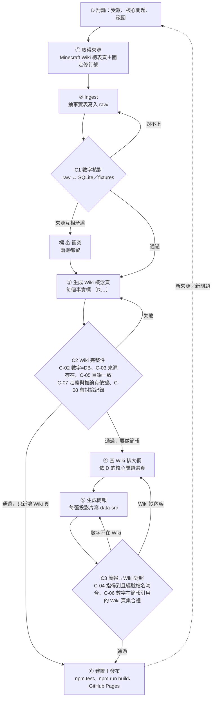

# LLM Wiki → 教學簡報：Loop／Graph 設計、執行紀錄與反思

- 知識庫：[`llm-wiki/`](../llm-wiki/README.md)（8 篇 raw → 7 頁概念頁）
- 簡報：[`slides/index.html`](../slides/index.html)，線上版 <https://finalhope487.github.io/minecraft-dungeons-wiki/slides/>
- 檢查器：[`tools/check-llm-wiki.mjs`](../tools/check-llm-wiki.mjs)，執行 `node tools/check-llm-wiki.mjs`

## Graph

文字版：**討論 → 取得來源 → Ingest → [數字核對] → 寫 Wiki → [Wiki 完整性檢查] →（只新增 Wiki 頁就直接發布；要做簡報則）查 Wiki 排大綱 → 產生簡報 → [簡報↔Wiki 對照] → 發布**

### 新增一頁概念頁

不需要新增投影片。照這個順序做，每一步的檢查都是 `node tools/check-llm-wiki.mjs`：

1. 在 `llm-wiki/wiki/log.md` 新增一筆 D 紀錄，寫明受眾、核心問題、範圍，並用 `- **涉及概念頁**：W8` 列出要新增的頁（C-08）。
2. 需要的來源不在 `raw/` 裡就先補 raw（回到 ① ②），事實表要有編號。
3. 新增 `wiki/<名稱>.md`，標題 `# W8 · 名稱`；有數字的行標 `〔R…〕`（C-03），推論寫出依據。
4. 在 `index.md` 的「概念頁」表加一列，「用到的 raw」要和頁面實際引用的 R 一致（C-05）。
5. 跑 checker、`npm test`、`npm run build`。要不要做成簡報，另外決定。

## 哪些步驟會重複執行

| 迴圈 | 範圍 | 什麼時候跑 | 停止條件 |
|---|---|---|---|
| Ingest 迴圈 | ② ↔ C1 | 每加一篇來源 | raw 的每個數字都對得上 SQLite，或已標成衝突 |
| Wiki 迴圈 | ③ ↔ C2 | 每改一頁 Wiki | `check-llm-wiki.mjs` 的 C-02、C-03、C-05、C-07、C-08 全過 |
| 簡報迴圈 | ⑤ ↔ C3，必要時退回 ④ | 每改一張投影片 | C-04、C-06 全過 |
| 外層迴圈 | ⑥ → D | 有新來源或讀者回饋 | — |

## 哪些地方要檢查或重新生成

| 檢查點 | 檢查什麼 | 失敗時退回哪裡 | 自動化 |
|---|---|---|---|
| C1 | raw 的數字和 repo 已驗收資料一致；兩篇來源說法不同時要標出來 | ② 重新抽取 | 人工＋既有 `npm test` |
| C2 | Wiki 數字 = SQLite（C-02）；任何行（段落、標題、清單、表格）有數字就要有來源標記，標記寫壞（未閉合、行內程式碼、壞編號）算失敗，標記指到的 raw 與事實編號真的存在（C-03）；raw／wiki 標題編號有效、`index.md` 目錄與實際文件和來源引用一致（C-05）；名詞定義有來源、〔推論〕寫出依據（C-07）；每頁概念頁都在 `log.md` 某筆 D 紀錄的「涉及概念頁」裡（C-08） | ③ 重寫該頁 | ✅ |
| C3 | 投影片指到的 W 編號與檔名吻合且存在（C-04）；投影片上的百分比與秒數，在整份簡報引用的 Wiki 頁集合裡找得到，不是逐張比對（C-06） | 數字錯 → ⑤；Wiki 缺內容 → ④ 或 ③ | ✅ |

## 為什麼這樣設計

- **Wiki 是簡報和原始資料之間唯一的介面。** 簡報只能從 Wiki 拿內容，不能直接讀 raw。這樣 C3 只要比對兩份檔案，就知道簡報有沒有「自己編」。
- **Wiki 是知識層，簡報只是下游。** Wiki 可以有簡報還沒用到的頁。舊版 C-05 要求每頁 Wiki 都被簡報引用，等於讓下游決定上游頁面能不能存在，新增概念頁就得硬塞一張投影片，所以改成檢查目錄一致（C-05）和討論紀錄（C-08）。
- **每層都有一個檢查點，失敗只退一步。** 錯誤在哪一層被抓到，就在哪一層修，不用整條重跑。
- **檢查要能自動跑。** 人工檢查會漏，第一次執行就證明了這點（見下方 C-run-1）。
- **衝突不是錯誤。** Wiki 本身說法不一致時，不讓 LLM 選邊，而是走 ⚠ 分支兩邊都保留。否則 LLM 會挑一個看起來合理的寫上去，讀者無從得知。

## 實際執行紀錄

完整時間序見 [`llm-wiki/wiki/log.md`](../llm-wiki/wiki/log.md)。

| 次 | 結果 | 失敗項 | 處理 |
|---|---|---|---|
| C-run-1 | 42／46 | 3 × C-03（數字行缺來源標記）、1 × C-04（workflow 文件未寫） | 補標記 |
| C-run-1b | — | 發現 C3 沒檢查數字本身 | 新增 C-06 |
| C-run-2 | 60／61 | C-04 投影片 17 | 寫本文件 |
| C-run-3 | 61／61 ✅ | — | — |
| C-run-4（11-24） | 62／62 | 全過，但人工稽核發現 7 處〔推論〕無來源、名詞表 13 個定義無來源 | 回 ① 補來源 R8 |
| C-run-5 | — | 發現 C-03 只看含數字的行 | 新增 C-07 |
| C-run-6 | 70／70 ✅ | — | — |
| C-run-7（強化後） | 71／73 → 73／73 ✅ | C-03：`player-vs-mob.md` 一個段落裡的 7／12／105 沒有來源標記（舊版只看清單與表格，漏掉）；C-08：七頁概念頁都沒有 D 紀錄列出 | 標 `〔R7 統計〕`（出處是 R7 的統計段）；D-01 補「涉及概念頁」 |

前置階段（11-15 ～ 11-18 做圖鑑網站時）在 C1 節點抓到的問題：

| 問題 | 發現方式 | 結果 |
|---|---|---|
| 裝備總數：頁首 224 vs 具名清單 228 | 和具名清單逐筆比對 | 以具名清單為準，4 件標未實裝 |
| 神器總數：頁首 46 vs 表格 45 | 和 Item 頁清單交叉比對 | 以表格為準 |
| 7 筆神器英文描述抽錯 | 逐頁重比 `In-game description` | 修正 |
| Critical Hit 玩家／怪物效果不同 | 使用者發現 | 124 筆附魔全部分兩側重查 |
| Committed、Electrified 來源互相矛盾 | 兩側稽核 | 標 `conflicting_sources` |

## 反思

### 哪一個節點最常出錯？

**② Ingest（抽取）和 ③ 生成 Wiki 頁**，兩者都是「LLM 把一份文字改寫成另一種格式」的節點。

- Ingest 的錯是**數字和原文抽錯**：照抄頁首統計（224、46），沒和清單對；神器描述抽錯 7 筆。
- 生成 Wiki 的錯是**來源標記被丟掉**：這次 C-run-1 的 3 個失敗全在這裡。數字沒錯，但改寫成表格或條列時，`〔R…〕` 不見了。

相對地，⑤ 生成簡報這次沒有出錯，因為它的輸入（Wiki）已經過兩道檢查。

### 把檢查往前移到了哪一個步驟？

1. **Critical Hit 問題讓檢查從「簡報／呈現」移到 ② Ingest。** 原本只在網站詳情頁顯示效果，沒有區分玩家和怪物。發現差異後改成在 ingest 時就**強制分兩側記錄**，每條標來源、推論、可信度（`docs/audits/enchantment-effect-facts.json`，253 條）。等到生成時才發現，就要回頭重查 124 筆。
2. **頁首數字和清單不一致，讓 C1 改成「一律以具名清單計數」。** 這條規則在抽取當下就要套用，不等到最後才比總數。
3. **來源標記遺失，讓 C2 從人工抽查改成每次寫入就自動跑 C-03。** 以前要到做簡報時才發現某個數字查不到出處。
4. **名詞與背景沒有來源，讓檢查回到 ① 選來源。** 原本 7 篇來源都是物品總表，沒有一篇講遊戲本身，所以 W1 的背景只能寫〔推論〕。這不是生成 Wiki 時能修的，要回頭補一篇來源（R8）。之後選來源時先列出簡報要講的名詞，確認每個名詞都有來源會提到。

### 有沒有因此修改 workflow／graph？為什麼？

有，改了三處：

| 改了什麼 | 為什麼 |
|---|---|
| C1 加上「⚠ 衝突」分支，不再只有「通過／退回」 | Committed 和 Electrified 的兩篇來源都是 Wiki 自己寫的，退回重抽也不會變。需要一條「保留兩邊」的路，否則 LLM 會自己挑一個。 |
| C3 新增 C-06（簡報數字必須在 Wiki 找得到） | 第一版 C3 只檢查投影片「有沒有指到」Wiki 頁，不檢查內容。投影片可以寫錯數字卻通過檢查。 |
| C3 的失敗分成兩條路：數字錯退回 ⑤，Wiki 缺內容退回 ④／③ | 如果簡報需要的內容 Wiki 沒有，在簡報裡補是錯的，要先補 Wiki，否則 Wiki 就不再是唯一來源。 |
| C2 新增 C-07（名詞定義要有來源、〔推論〕要寫依據） | C-03 只看含數字的行，名詞定義和背景說明沒有數字，舊檢查全過卻漏掉 13 個無來源定義。 |

**還沒做到的**：
- 自動檢查只證明結構與引用「存在」：標記指到的 raw 和事實編號有、數字行有標記、目錄一致。標記指到的那條事實是否真的支持這句話，沒有檢查，仍要人工。
- 「同一行才算有來源」：標記放在相鄰的另一行不算。中文數字（如「三倍」）不算數字。
- C-06 只比對 `%` 和 `秒`，像「124 個」「三倍傷害」這類文字型數字沒涵蓋。
- C-08 只確認 `log.md` 有寫，不能證明使用者事前真的同意。
- 所有效果都是文件查證，沒有遊戲內實測。
